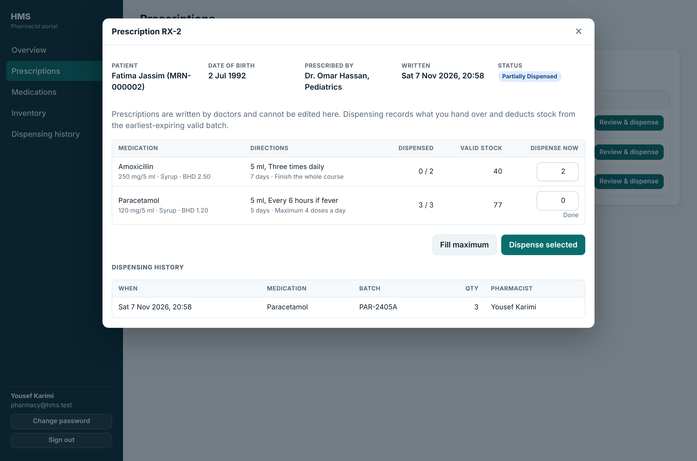

# AWS Hospital Management System

A full-stack hospital management platform with five roles (Admin, Doctor, Receptionist, Pharmacist, Patient), built as a portfolio project for **Cloud / Infrastructure Engineer** roles. The application runs locally with Docker; the AWS architecture and Terraform code are the next phase (see [Roadmap](#roadmap)).

> **Educational project.** All patients, doctors and medications are fictional. This is not a certified clinical system and makes no HIPAA or other compliance claim.



## Features

| Role | What they can do |
|---|---|
| **Admin** | Dashboard (patients, doctors, staff, appointments, pharmacy figures), manage users, departments, specialties and settings, read the audit log |
| **Doctor** | Daily schedule, assigned patients and their visit history, record diagnoses, write prescriptions, update appointment status |
| **Receptionist** | Register and search patients, book / reschedule / cancel appointments with a live slot picker |
| **Pharmacist** | Medication catalogue, batch-level inventory with expiry tracking, low-stock and expired alerts, prescription queue, dispensing with full history |
| **Patient** | Profile (contact details), book and cancel appointments, prescriptions with dispensing status, previous visits |

A prescription written by a doctor is in the pharmacist's queue immediately (status `Pending`) and the patient sees the status change as it is dispensed.

### Pharmacy business rules (enforced on the backend and by database constraints)

1. Expired stock can never be dispensed.
2. Stock can never go negative.
3. Cannot dispense more than the available stock or more than was prescribed.
4. Dispensing runs in one database transaction: all items succeed or nothing changes.
5. Every dispensing is recorded (who, what, which batch, when, price at that time).
6. Duplicate dispensing is prevented (idempotency key; double clicks and retries deduct once).
7. Pharmacists cannot modify prescriptions: no such endpoint exists.

## Technology

Node.js 22 + Express 4, MySQL 8, vanilla HTML / CSS / JavaScript (ES modules, no framework), bcrypt, JWT, zod, helmet, Docker. Planned: AWS (VPC, EC2, ALB, Auto Scaling, RDS, S3, CloudWatch), Terraform, GitHub Actions.

## Documentation

- [Database design and ER diagram](docs/database.md)
- [Authentication, authorization and role permissions](docs/security/authentication.md)

## Run it locally

You need Node.js 22+ and either Docker or a local MySQL 8 / MariaDB 10.5+.

### Option A: Docker (app + MySQL)

```bash
cp .env.example .env
# edit .env: set DB_PASSWORD, DB_ROOT_PASSWORD and JWT_SECRET
#   JWT_SECRET: node -e "console.log(require('crypto').randomBytes(48).toString('hex'))"
docker compose -f docker/docker-compose.yml --env-file .env up --build
docker compose -f docker/docker-compose.yml --env-file .env exec app node backend/scripts/seed.js
```

Open http://localhost:3000. The seed command prints the demo accounts and a generated password (shown once).

### Option B: without Docker

```bash
mysql -u root -p -e "CREATE DATABASE hms CHARACTER SET utf8mb4 COLLATE utf8mb4_unicode_ci;
  CREATE USER 'hms_app'@'localhost' IDENTIFIED BY 'choose-a-password';
  GRANT SELECT,INSERT,UPDATE,DELETE ON hms.* TO 'hms_app'@'localhost';"
mysql -u root -p hms < database/schema.sql

cp .env.example .env        # set DB_PASSWORD (same as above) and JWT_SECRET
cd backend
npm install
npm run seed                # prints demo accounts + a generated password
npm start                   # http://localhost:3000
```

### Demo accounts (created by the seed script)

| Role | Email |
|---|---|
| Admin | admin@hms.test |
| Doctor | dr.sara@hms.test (also dr.omar@hms.test, dr.layla@hms.test) |
| Receptionist | reception@hms.test |
| Pharmacist | pharmacy@hms.test |
| Patient | ahmed@hms.test (also fatima@hms.test, mohammed@hms.test) |

All use the password printed by the seed script (or `SEED_PASSWORD` if you set it).

## Tests

The automated tests run against a real database that has the schema loaded and the seed applied. Use a separate database, never one with real data.

```bash
cd backend
npm test        # 52 tests: authentication, RBAC, pharmacy rules, appointments
```

They cover, among other things: forged and expired tokens, role escalation attempts, a patient reading another patient's data, SQL-injection input, negative stock, expired stock, over-dispensing, rollback of a half-finished dispensing, duplicate and simultaneous requests, two pharmacists racing for the last units, and double-booking races.

## Security implementation (summary)

bcrypt password hashes, JWT in an HttpOnly + SameSite=Strict cookie, role loaded from the database on every request, deactivated accounts lose access immediately, row-level scoping for patients and doctors, parameterised SQL everywhere, zod validation that drops unknown fields, login rate limiting, helmet security headers and CSP, audit log. Details in [docs/security/authentication.md](docs/security/authentication.md).

## Project structure

```
frontend/   vanilla JS app (shell, per-role page modules loaded on demand)
backend/    Express API (routes, middleware, services, seed script, tests)
database/   schema.sql
docker/     Dockerfile + docker-compose.yml
docs/       database, security, screenshots (architecture, monitoring, DR coming with the AWS phase)
terraform/  infrastructure as code (next phase)
```

## Roadmap

- [x] Application: five role dashboards, pharmacy module, tests
- [x] Docker packaging
- [ ] AWS infrastructure as Terraform: VPC (public / private app / private DB subnets, two AZs), ALB, EC2 Auto Scaling, RDS MySQL (private), S3, KMS, IAM roles, CloudWatch alarms + SNS, CloudTrail
- [ ] GitHub Actions CI (tests) and deployment with OIDC
- [ ] Incident simulations, backup / restore test, architecture and cost documentation

## License

MIT
