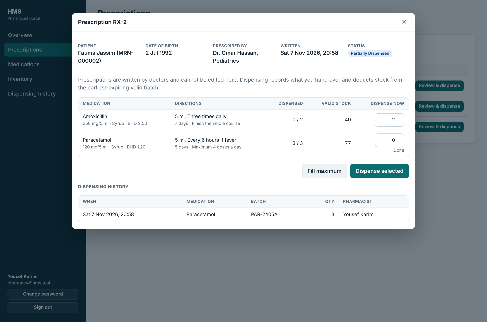
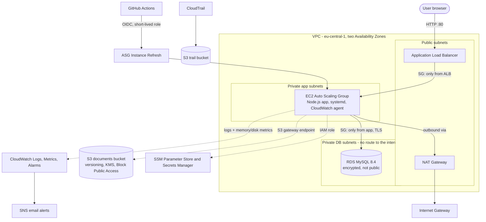

# AWS Hospital Management System

A full-stack hospital management platform with five roles (Admin, Doctor, Receptionist, Pharmacist, Patient), built as a portfolio project for **Cloud / Infrastructure Engineer** roles. It runs locally with Docker and on AWS, deployed with Terraform and a GitHub Actions CI/CD pipeline (see [AWS architecture](#aws-architecture)).

> **Educational project.** All patients, doctors and medications are fictional. This is not a certified clinical system and makes no HIPAA or other compliance claim.



## Features

| Role | What they can do |
|---|---|
| **Admin** | Dashboard (patients, doctors, staff, appointments, pharmacy figures), manage users, departments, specialties and settings, read the audit log |
| **Doctor** | Daily schedule, assigned patients and their visit history, record diagnoses, write prescriptions, update appointment status |
| **Receptionist** | Register and search patients, book / reschedule / cancel appointments with a live slot picker |
| **Pharmacist** | Medication catalogue, batch-level inventory with expiry tracking, low-stock and expired alerts, prescription queue, dispensing with full history |
| **Patient** | Profile (contact details), book and cancel appointments, prescriptions with dispensing status, previous visits |

A prescription written by a doctor is in the pharmacist's queue immediately (status `Pending`) and the patient sees the status change as it is dispensed.

### Pharmacy business rules (enforced on the backend and by database constraints)

1. Expired stock can never be dispensed.
2. Stock can never go negative.
3. Cannot dispense more than the available stock or more than was prescribed.
4. Dispensing runs in one database transaction: all items succeed or nothing changes.
5. Every dispensing is recorded (who, what, which batch, when, price at that time).
6. Duplicate dispensing is prevented (idempotency key; double clicks and retries deduct once).
7. Pharmacists cannot modify prescriptions: no such endpoint exists.

## Technology

| Layer | Stack |
|---|---|
| Frontend | HTML5, CSS3, vanilla JavaScript (ES modules, no framework) |
| Backend | Node.js 22, Express 4, REST API, zod validation, bcrypt, JWT, helmet |
| Database | MySQL 8 (RDS MySQL 8.4 on AWS) |
| Cloud | AWS (VPC, EC2 Auto Scaling, ALB, RDS, S3, KMS, IAM, CloudWatch, SNS, CloudTrail, Systems Manager) |
| Infrastructure as Code | Terraform (7 modules, 1 dev environment) |
| DevOps | Docker, Git, GitHub Actions with OIDC |

## Documentation

- [Database design and ER diagram](docs/database.md)
- [Authentication, authorization and role permissions](docs/security/authentication.md)

## AWS architecture



**Traffic flow:** browser → ALB (public subnet) → EC2 in a private app subnet → RDS in an isolated DB subnet. Each hop is allowed only by a Security Group that references the previous tier (not by IP ranges). No server has a public IP and there is no SSH: administration goes through Systems Manager Session Manager.

### AWS services and why they are used

| Service | Purpose | Notes |
|---|---|---|
| VPC, subnets, route tables, IGW | Three-tier network across two AZs | DB subnets have no internet route |
| NAT Gateway | Lets private servers reach package repos and GitHub | Most expensive networking part; optional (flag in the Terraform module) |
| Security Groups | ALB → app → DB chain | App SG accepts traffic only from the ALB SG, DB SG only from the app SG |
| ALB + Target Group | Distributes traffic, health check on `/health` | `/health` is liveness only, `/health/ready` also checks the DB |
| EC2 + Launch Template + Auto Scaling | Application servers, self-healing, CPU target tracking | Amazon Linux 2023, IMDSv2 required, bootstrap by user data |
| RDS MySQL 8.4 | Managed database, private, encrypted with KMS, TLS enforced by the app | Master password managed by Secrets Manager |
| S3 | Document storage and CloudTrail logs | Block Public Access, versioning, lifecycle rules, KMS |
| KMS | Customer-managed key for RDS and S3 | Key rotation enabled |
| IAM roles | Instance role and CI/CD deploy role, least privilege | No access keys on servers or in GitHub |
| Systems Manager | Session Manager access (no SSH), Parameter Store for the JWT secret | |
| CloudWatch + SNS | Logs, memory and disk metrics (agent), alarms, dashboard, email alerts | |
| CloudTrail | API audit log to S3 | |
| AWS Budgets | Monthly cost alert | |
| CloudFront | **Not used.** The app is a single dynamic origin, so a CDN adds cost without a clear benefit here | Would be added with HTTPS and a custom domain |

### Infrastructure as Code

```
terraform/
  modules/
    networking/   VPC, subnets, route tables, IGW, optional NAT, S3 endpoint
    security/     Security Groups, IAM role and instance profile, KMS key
    storage/      S3 documents bucket and its policy
    database/     RDS, subnet group, parameter group
    compute/      Launch Template, ALB, Target Group, Auto Scaling, JWT secret
    monitoring/   SNS, CloudWatch alarms, dashboard, CloudTrail
    cicd/         GitHub OIDC trust and the deploy role
  environments/
    dev/          wires the modules together (providers, variables, outputs)
```

### Deploy

Prerequisites: an AWS account, AWS CLI configured with an IAM user (not root), Terraform 1.x.

```bash
cd terraform/environments/dev
# create terraform.tfvars (gitignored) with: alert_email = "you@example.com"
terraform init
terraform plan
terraform apply
terraform output app_url                         # open this URL
```

The first instance creates the schema automatically (`backend/scripts/init-db.js`, protected by a database lock so parallel instances do not collide). Demo data is loaded once through Session Manager:

```bash
cd /opt/hms/app && sudo -u hms node scripts/seed.js
```

Remove everything when you are done (the stack costs money while it runs):

```bash
terraform destroy
```

### CI/CD pipeline (GitHub Actions)

| Job | What it does |
|---|---|
| `test` | MySQL 8.4 service container, creates schema and demo data, `npm audit`, runs the 52 backend tests |
| `docker` | Builds the Docker image |
| `terraform` | `terraform fmt -check` and `terraform validate` |
| `deploy` | Runs only on `main`, only after the three jobs above pass, and waits for a manual approval on the `production` environment. Authenticates to AWS with **OIDC** (no stored keys), then starts an Auto Scaling **instance refresh**; new servers pull the latest `main` |

The deploy role can only refresh one Auto Scaling Group, and its trust policy accepts only this repository and only the `production` environment.

### Monitoring

CloudWatch agent on every server sends memory and disk usage and the application log. Alarms (email through SNS) cover EC2 CPU, instance status checks, memory, disk, unhealthy ALB targets, ALB 5xx errors, RDS CPU, RDS free storage and RDS connections. A CloudWatch dashboard shows the overall state. CloudTrail records API activity.

### Security implementation (infrastructure)

- Database in isolated subnets, not publicly accessible, encrypted at rest (KMS), TLS from the app
- Security Group chain instead of open ports; no SSH, no public IPs on servers
- IAM roles instead of access keys; least-privilege policies; IMDSv2 required
- Secrets in Secrets Manager and SSM SecureString, never in the repository
- S3 Block Public Access, versioning and encryption
- CloudTrail for API auditing, application audit log in the database
- GitHub to AWS through OIDC with a narrowly scoped trust policy

### Backup and recovery

- RDS automated backups are enabled (retention is 1 day because the account is on the AWS Free Plan, which caps it; production would use 7 days or more)
- S3 versioning and lifecycle rules on the document bucket
- The whole environment can be rebuilt from Terraform, and the schema is created automatically on a new database

### Cost

The stack is meant to be deployed, documented and destroyed. While running it costs roughly **$2.5 to $3 per day**, mostly NAT Gateway, ALB, RDS and EC2. An AWS Budget alert is part of the Terraform code.

### Screenshots

Project screenshots (application and AWS) are in the [`screenshots/`](screenshots/) folder.

### Not done (honest scope)

- Incident simulations (high CPU, instance failure, DB connectivity, app down, low disk) were not performed
- A point-in-time restore test of RDS was not performed
- HTTPS and a custom domain (the ALB listens on HTTP only, so cookies are set with `COOKIE_SECURE=false` for this demo)
- Multi-environment setup (only `dev`) and remote Terraform state

### Lessons learned

- RDS on the AWS Free Plan rejects backup retention above 1 day; MySQL 8.0 triggers Extended Support fees, so 8.4 was used
- A new Auto Scaling Group can fail right after the account's first use because the service-linked role is still propagating; waiting and re-applying fixed it
- A health check can fail for reasons that have nothing to do with AWS: a file missing from Git (`init-db.js`) made every instance unhealthy, and the instance system log showed it
- A GitHub OIDC provider is unique per account, so the code reuses the existing one with a data source instead of creating a duplicate
- GitHub now puts numeric owner and repository IDs in the OIDC `sub` claim, so a trust policy written with plain names is rejected; printing the real token claims in a debug step found it
- Liveness and readiness are different checks: the load balancer uses `/health`, so a database outage does not make the ALB kill every server

## Run it locally

You need Node.js 22+ and either Docker or a local MySQL 8 / MariaDB 10.5+.

### Option A: Docker (app + MySQL)

```bash
cp .env.example .env
# edit .env: set DB_PASSWORD, DB_ROOT_PASSWORD and JWT_SECRET
#   JWT_SECRET: node -e "console.log(require('crypto').randomBytes(48).toString('hex'))"
docker compose -f docker/docker-compose.yml --env-file .env up --build
docker compose -f docker/docker-compose.yml --env-file .env exec app node backend/scripts/seed.js
```

Open http://localhost:3000. The seed command prints the demo accounts and a generated password (shown once).

### Option B: without Docker

```bash
mysql -u root -p -e "CREATE DATABASE hms CHARACTER SET utf8mb4 COLLATE utf8mb4_unicode_ci;
  CREATE USER 'hms_app'@'localhost' IDENTIFIED BY 'choose-a-password';
  GRANT SELECT,INSERT,UPDATE,DELETE ON hms.* TO 'hms_app'@'localhost';"
mysql -u root -p hms < database/schema.sql

cp .env.example .env        # set DB_PASSWORD (same as above) and JWT_SECRET
cd backend
npm install
npm run seed                # prints demo accounts + a generated password
npm start                   # http://localhost:3000
```

### Demo accounts (created by the seed script)

| Role | Email |
|---|---|
| Admin | admin@hms.test |
| Doctor | dr.sara@hms.test (also dr.omar@hms.test, dr.layla@hms.test) |
| Receptionist | reception@hms.test |
| Pharmacist | pharmacy@hms.test |
| Patient | ahmed@hms.test (also fatima@hms.test, mohammed@hms.test) |

All use the password printed by the seed script (or `SEED_PASSWORD` if you set it).

## Tests

The automated tests run against a real database that has the schema loaded and the seed applied. Use a separate database, never one with real data.

```bash
cd backend
npm test        # 52 tests: authentication, RBAC, pharmacy rules, appointments
```

They cover, among other things: forged and expired tokens, role escalation attempts, a patient reading another patient's data, SQL-injection input, negative stock, expired stock, over-dispensing, rollback of a half-finished dispensing, duplicate and simultaneous requests, two pharmacists racing for the last units, and double-booking races.

## Security implementation (application)

bcrypt password hashes, JWT in an HttpOnly + SameSite=Strict cookie, role loaded from the database on every request, deactivated accounts lose access immediately, row-level scoping for patients and doctors, parameterised SQL everywhere, zod validation that drops unknown fields, login rate limiting, helmet security headers and CSP, audit log. Details in [docs/security/authentication.md](docs/security/authentication.md).

## Project structure

```
frontend/      vanilla JS app (shell, per-role page modules loaded on demand)
backend/       Express API (routes, middleware, services, scripts, tests)
database/      schema.sql
docker/        Dockerfile + docker-compose.yml
terraform/     modules and the dev environment
.github/       GitHub Actions workflow (CI/CD)
docs/          database and security documentation
screenshots/   application and AWS screenshots
```

## Roadmap

- [x] Application: five role dashboards, pharmacy module, 52 tests
- [x] Docker packaging
- [x] AWS infrastructure as Terraform (network, ALB, Auto Scaling, RDS, S3, KMS, IAM)
- [x] CloudWatch monitoring, SNS alerts, CloudTrail
- [x] GitHub Actions CI/CD with OIDC deployment
- [ ] Incident simulations and RDS restore test
- [ ] HTTPS with a custom domain

## License

MIT