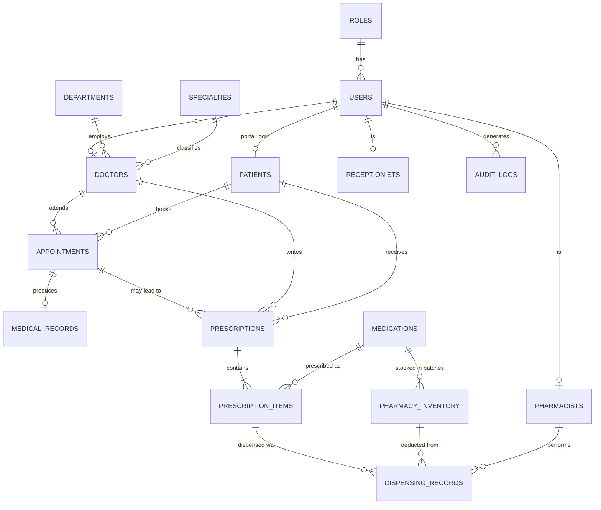

# Database design

MySQL 8 (also tested on MariaDB 10.11). Schema: [`database/schema.sql`](../database/schema.sql). All data is fictional.

## ER diagram

## The key chain: Doctor → Prescription → Items → Pharmacy → Patient

1. A **doctor** creates a `prescriptions` row (status `Pending`) plus one `prescription_items` row per medication (dose, frequency, days, instructions, `quantity_prescribed`). The status `Pending` is what makes it appear in the pharmacist queue; no integration step is needed.
2. A **pharmacist** dispenses. In one transaction the app locks the prescription, picks non-expired `pharmacy_inventory` batches (earliest expiry first), deducts stock, inserts `dispensing_records` (who, which batch, how many, price at that time), raises `prescription_items.quantity_dispensed`, and sets the prescription to `Partially Dispensed` or `Dispensed`.
3. The **patient** reads the same `prescriptions` / `prescription_items` rows (scoped to their own `patient_id`) and sees the status and how much was collected.

## Rules enforced by the database itself

| Rule | Mechanism |
|---|---|
| Stock can never be negative | `CHECK (quantity >= 0)` on `pharmacy_inventory` |
| Cannot dispense more than prescribed | `CHECK (quantity_dispensed <= quantity_prescribed)` |
| Same doctor cannot be double-booked; same patient cannot be in two places | `UNIQUE (doctor_id, active_slot)` and `UNIQUE (patient_id, active_slot)`; `active_slot` is a generated column that is `NULL` for cancelled / no-show rows, so cancelled slots can be re-booked |
| Duplicate dispensing (double click, retry) | `UNIQUE (request_key, prescription_item_id, inventory_id)` plus an idempotency check in the service |
| One diagnosis record per appointment | `UNIQUE (appointment_id)` on `medical_records` |
| A medication appears once per prescription | `UNIQUE (prescription_id, medication_id)` |
| Referential integrity everywhere | Foreign keys on every relationship |

## Why stock is stored per batch

Expiry belongs to a **batch**, not to a medication. A medication can have one batch that expired last month and another that is valid for two years; only the valid one may be dispensed. `pharmacy_inventory` therefore has one row per `(medication, batch_no)` with its own quantity and `expiry_date`.

## Indexes

Every foreign key is indexed. Additional indexes match the real queries: `appointments (doctor_id, scheduled_at)`, `appointments (status, scheduled_at)`, `prescriptions (status, created_at)` for the pharmacist queue, `pharmacy_inventory (medication_id, expiry_date)` for batch selection, `patients (full_name)` and `(phone)` for desk search, `audit_logs (created_at)`.

## Passwords

`users.password_hash` holds a bcrypt hash (12 rounds by default). Plain passwords are never stored or logged.
